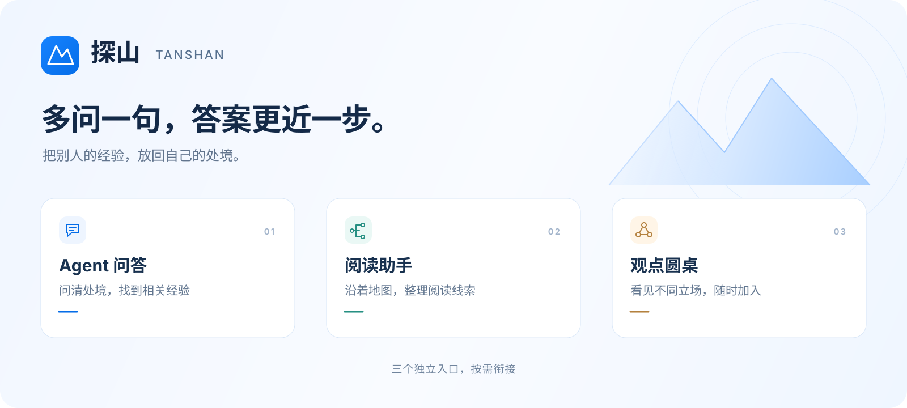
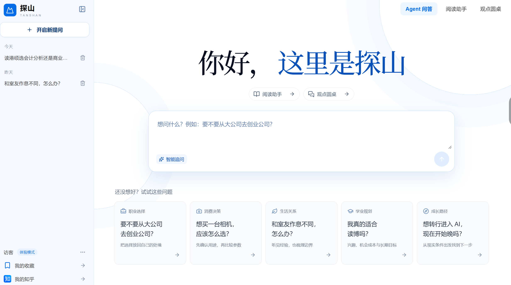
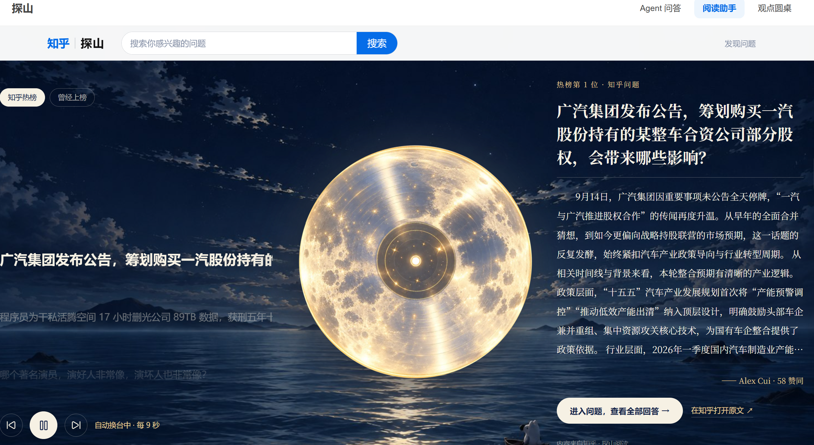
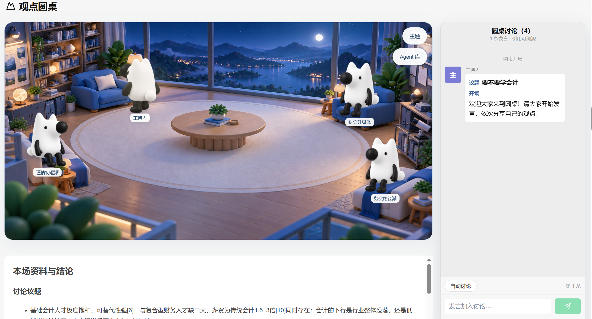

<p align="center">
  
</p>

# 探山 Tanshan

**把别人的经验，放回自己的处境。**

面对一个没有标准答案的问题，探山帮你澄清真正关心的事、找到值得读的知乎经验，再从不同立场继续讨论。工作、消费、生活与学习，都可以从一个具体问题开始。

**[在线体验 ↗](https://tanshan-270489-8-1443398117.sh.run.tcloudbase.com/demo)** · [一分钟演示](#一分钟演示) · [快速开始](#快速开始) · [文档导航](docs/README.md)

[](https://github.com/Alia0415/tanshan-agent/actions/workflows/ci.yml)


## 一分钟演示

**两份 Offer，怎么选？** 用一个求职困境，分别看看问答、阅读与讨论能帮上什么忙。

[](docs/demo/offer-demo.mp4)

[查看视频文件](docs/demo/offer-demo.mp4) · [下载 MP4](https://github.com/Alia0415/tanshan-agent/raw/refs/heads/main/docs/demo/offer-demo.mp4) · [演示说明与时间轴](docs/demo/README.md)

60 秒 · 1080p · 无配音。视频为产品流程动效演示；三个功能独立使用，也能围绕同一问题按需关联。

## 三个独立入口

| Agent 问答 | 阅读助手 | 观点圆桌 |
| --- | --- | --- |
| 先问清处境，再找适合你的经验。 | 把分散的讨论，整理成可探索的阅读路线。 | 让不同立场坐到一张桌前，随时加入讨论。 |
| [](docs/screenshots/home.png) | [](docs/screenshots/reading.png) | [](docs/screenshots/roundtable.png) |
| 动态追问、可编辑条件、知乎帖子推荐与筛选说明。 | 热榜与曾经上榜的问题、阅读地图、文章思维导图。 | 原生角色动作与观点气泡、议题交锋、针对插话的回应。 |
| `/` | `/reading` | `/roundtable` |

### Agent 问答：答案从你的处境出发

“异地高薪加班多，本地低薪但稳定，该怎么选？”

探山会结合补充信息继续追问，例如每周留出的个人项目时间是不是硬性约束。最多 5 轮，随时可以跳过；结果优先展示知乎帖子、搜索摘要、筛选说明和原帖入口，辅助总结按需展开。修改条件后可以重新检索，也能从历史问题继续。

### 阅读助手：先找到阅读重点

从热榜、曾经上榜的问题或搜索发现话题；对已记录上榜的问题，确认关注点后生成阅读地图。切换路线，查看对应文章，再用**基于知乎搜索摘要的文章思维导图**预览内容结构，决定是否打开原文深入阅读。

### 观点圆桌：看见分歧，也能追问

主持人与 2–3 个立场角色围绕检索资料讨论，动作和文字气泡与发言同步。先看观点，再展开论据、完整发言与来源；用户插话后，由相关角色回应，也可从 Agent 库邀请补充角色。

三个入口不要求依次使用。阅读页可把**问题标题**带到问答或圆桌，确认提交后才开始请求。

## 在线体验

**[打开探山体验页 ↗](https://tanshan-270489-8-1443398117.sh.run.tcloudbase.com/demo)**

公开体验使用原创预置样例，保留 AI 追问、阅读生成与多立场讨论；页面会标明样例身份，内容不代表实时知乎热榜或检索结果。体验额度由全站访客共享，知乎账号登录与账号内容在此模式下不可用。

本地标准模式可接入真实知乎检索、知乎直答、DeepSeek 与 OAuth。两种模式的范围和部署方式见 [公开体验说明](docs/ONLINE_DEMO.md)。

## 快速开始

需要 **Node.js 24+** 和 npm。项目使用 Node.js 内置 SQLite。

```sh
git clone https://github.com/Alia0415/tanshan-agent.git
cd tanshan-agent
npm ci
```

复制配置示例：

```powershell
# Windows PowerShell
Copy-Item .env.example .env.local
```

```sh
# macOS / Linux
cp .env.example .env.local
```

在 `.env.local` 中设置以下开关，即可先运行三个入口的本地脚本样例，无需 API 密钥：

```dotenv
WENSHAN_PUBLIC_DEMO=1
```

```sh
npm run dev
```

打开 [http://localhost:3000/demo](http://localhost:3000/demo)。添加服务端 `DEEPSEEK_API_KEY` 后可体验 AI 生成；模型请求会消耗对应服务额度。切换配置后重启服务并新建会话。

接入真实知乎资料、OAuth 和生产部署，请看 [运行指南](docs/GETTING_STARTED.md)、[详细配置](docs/CONFIGURATION.md) 与 [部署说明](docs/ONLINE_DEMO.md)。

## 工程概览

**Next.js 16 · React 19 · TypeScript · Node.js SQLite · Zod**

```text
src/app/          页面与 HTTP 接口
src/components/   问答、阅读与圆桌交互
src/lib/          会话编排、检索、模型与存储
agent/            Agent 定义与宿主接入说明
tests/            受控测试
scripts/          导出与显式联调脚本
deploy/           Docker Compose 与反向代理模板
docs/             产品、演示、配置与架构文档
prototype/        历史原型，非主应用启动入口
```

| 命令 | 用途 |
| --- | --- |
| `npm run dev` | 本地开发 |
| `npm run check` | ESLint、TypeScript 与受控测试 |
| `npm run build` / `npm start` | 生产构建 / 启动 |
| `npm run test:public-demo` | 对无 AI 密钥的公开样例服务做 HTTP 验收 |

更多命令与贡献流程见 [贡献指南](CONTRIBUTING.md)。CI 在 push 和 PR 时运行安装、检查与构建。

## 文档与当前边界

| 想了解什么 | 从这里开始 |
| --- | --- |
| 产品演示与三入口使用 | [演示指南](docs/DEMO.md) · [视频说明](docs/demo/README.md) |
| 配置与上线 | [运行指南](docs/GETTING_STARTED.md) · [配置](docs/CONFIGURATION.md) · [公开体验部署](docs/ONLINE_DEMO.md) |
| 原理与接口 | [工程架构](docs/ARCHITECTURE.md) · [API](docs/API.md) · [观点圆桌](docs/ROUNDTABLE.md) |
| 知乎集成 | [Agent 范围](docs/AGENT_SCOPE.md) · [Agent 接入](agent/README.md) · [OAuth](docs/OAUTH.md) |
| 开发与验收 | [贡献指南](CONTRIBUTING.md) · [验收状态](docs/ACCEPTANCE.md) · [全部文档](docs/README.md) |

搜索摘要和导图不等于全文阅读；角色引用与相关性筛选也不等于独立事实核验。圆桌由同一模型模拟不同立场，角色动作与文字气泡不包含语音播报。

当前主要交付可运行的 Web 应用；知乎站内 Agent 的宿主适配与发布仍待完成。标准运行依赖单实例和持久磁盘；跨实例圆桌恢复、共享存储及额度边界见 [部署说明](docs/ONLINE_DEMO.md)。产品已更名为“探山”，现有 `WENSHAN_*` 配置名保留兼容。
